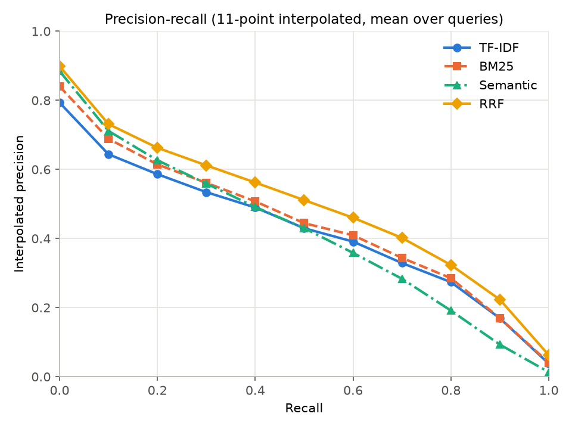

# MovieLens Movie Search

An information-retrieval search engine over the 62,423 MovieLens 25M movies, using
plot descriptions, user tags and genre metadata. It compares keyword search (TF-IDF,
BM25), meaning-based search (sentence embeddings) and their Reciprocal Rank Fusion
(RRF). It also includes an evaluation on tag-genome relevance judgments and a
Streamlit search interface.

## Setup

```bash
python -m venv .venv
source .venv/bin/activate        # Windows: .venv\Scripts\activate
pip install -r requirements.txt
```

1. **Dataset.** Download [MovieLens 25M](https://files.grouplens.org/datasets/movielens/ml-25m.zip)
   (262 MB) and unzip it into `data/`, so that `data/ml-25m/movies.csv` exists.
2. **Plot descriptions.** MovieLens has no plot text, so `links.csv` is used to fetch
   each movie's overview from TMDB. Get a free key at
   [themoviedb.org/settings/api](https://www.themoviedb.org/settings/api). Copy
   `.env.example` to `.env` and fill in `TMDB_READ_ACCESS_TOKEN` (or `TMDB_API_KEY`).
   `.env` is git-ignored; never put the key in `.env.example`. Then run:

   ```bash
   python src/fetch_plots.py           # ~62k requests, about 55 min; resumable, re-run to retry errors
   ```

3. **Build the processed data:**

   ```bash
   python src/preprocessing.py         # merges movies + tags + plots, builds the metadata index
   python src/text_preprocessing.py    # tokenizes, removes stop words, stems -> BM25 / TF-IDF input
   ```

| File (`data/ml-25m/`, git-ignored) | Contents | Used by |
|---|---|---|
| `plots.csv` | TMDB overview per movie (61,461 found, 855 not on TMDB) | preprocessing |
| `processed_movies.csv` | `text` (title, genres, plot, all tags) and `semantic_text` (title, genres, plot, distinct tags) | semantic search |
| `preprocessed_movies.csv` | stemmed `processed_text` | TF-IDF, BM25 |
| `movie_metadata.csv` | year, genres, average rating, number of ratings, TMDB/IMDb ids, plot | result display, minimum-ratings filter |

**Preprocessing:**
- *Tag and plot cleaning:* plots have HTML tags and entities, URLs, TMDB placeholder
  text ("No overview found.") and extra whitespace removed. Tags are lowercased and
  de-duplicated for the semantic text.
- *Tokenization and stemming:* text is lowercased, accents are folded, punctuation is
  removed, English stop words are dropped and words are Porter-stemmed.
- *Movie IDs:* `movieId` is the join key everywhere.

The first semantic search downloads `all-MiniLM-L6-v2` and encodes all movies (a few
minutes on CPU). The vectors are saved to `models/movie_embeddings.npy` and rebuilt
automatically whenever the CSV changes.

## Run the search interface

```bash
streamlit run src/app.py            # opens http://localhost:8501
```

- **Query box** and **ranking-method selector** (TF-IDF, BM25, Semantic, RRF) in the sidebar.
- **Minimum number of ratings** filter (default 0 = off). For example, 1,000 hides obscure
  titles. Each method's full ranking is filtered before taking the top 10, so the results
  are still that method's true top 10 among the qualifying movies.
- **Top 10 ranked results** (matching the P@10 / nDCG@10 evaluation): rank, title, year,
  genres, average rating, number of ratings, score and plot. RRF results also show each
  method's rank. RRF uses k = 60 and fuses the top 100 results of each method.

Empty queries, queries with no matches, and missing data each show a message instead
of an error. The first search with a method builds its index (TF-IDF and BM25 take
about 10 s; Semantic also loads the model). Later searches are instant.

## Evaluation

```bash
python src/build_relevance.py       # writes eval/queries.csv, eval/qrels.csv, eval/judged_movies.csv
python src/evaluate.py              # writes results/ (about 100 s once the embeddings exist)
pytest                              # 70 tests
```

**Test collection** (`eval/`):

- **Topics:** 30 tags from the MovieLens **tag genome** (time travel, heist, zombies,
  submarine, ...). The genome gives each of 13,816 movies a 0–1 relevance score for every
  tag. The scores come from a model trained on user tags, ratings and reviews, so every
  one of those movies is judged for every topic.
- **Relevance:** a movie is relevant if its genome score is ≥ 0.8. For nDCG it gets
  grade 2 at ≥ 0.9 and grade 1 at ≥ 0.8. Each topic has 26–311 relevant movies
  (118 on average), 3,551 judgments in total.
- **Queries (60):** each topic is searched twice. Once with the tag itself ("time travel"),
  and once with a description written without the tag's words and fixed before any
  system was run ("going back in time to change the past"). The second form tests
  matching by meaning rather than by word overlap.
- **Scoring:** rankings are restricted to the 13,816 judged movies, cut at 1,000 results,
  and RRF fuses those lists.
- **Metrics** (`src/metrics.py`):
  - Precision@5/10 and Recall@5/10.
  - MAP: average precision over the top 1,000, where relevant movies that are never retrieved count as 0.
  - nDCG@5/10.
  - 11-point interpolated precision-recall curves.

### Results (RRF k = 60)

| method   | P@5    | P@10   | R@5    | R@10   | MAP    | nDCG@5 | nDCG@10 |
|----------|-------:|-------:|-------:|-------:|-------:|-------:|--------:|
| TF-IDF   | 0.6367 | 0.6233 | 0.0408 | 0.0802 | 0.4160 | 0.5919 | 0.5883  |
| BM25     | 0.6733 | 0.6700 | 0.0458 | 0.0886 | 0.4379 | 0.6419 | 0.6398  |
| Semantic | 0.7400 | 0.6950 | 0.0478 | 0.0920 | 0.4090 | 0.6863 | 0.6571  |
| RRF      | **0.7500** | **0.7217** | **0.0480** | **0.0941** | **0.4870** | **0.7200** | **0.6956** |



- **RRF is best on every metric.** It has the highest precision at every recall level
  from 0.1 to 1.0.
- **Semantic is the strongest single method at the top of the ranking** (P@5, nDCG@10),
  because it also matches descriptions that share no words with the movie.
- **BM25 is the strongest single method on MAP.** BM25 beats TF-IDF on every metric.
- **Recall@5/10 are small by construction:** with 118 relevant movies on average, 10
  results can find at most about 8%. The PR curve shows recall over the full ranking.

The numbers are in `results/`: `comparison.md` and `comparison.csv` (the table),
`per_query_metrics.csv`, `pr_curve.png` and `pr_curve.csv`.

## Using the search functions

Run from `src/` or put `src/` on the path. Each retrieval module builds its index when imported.

```python
import search_engine

search_engine.search("space adventure", method="RRF", top_k=10, rrf_k=60, rrf_depth=100,
                     min_ratings=1000)   # optional: only movies with at least 1,000 ratings
# -> [{"rank", "movieId", "title", "score", "ranks": {"TF-IDF": .., "BM25": .., "Semantic": ..},
#      "genres", "year", "avg_rating", "num_ratings", "plot"}, ...]  best first

import bm25_search
bm25_search.search_movies("space adventure", top_k=10)   # top_k=None ranks every match
# -> [{"movieId": 260, "title": "Star Wars: Episode IV - A New Hope (1977)", "score": 13.08}, ...]
```

| System   | `score` means                         | Range        |
|----------|---------------------------------------|--------------|
| TF-IDF   | cosine similarity of TF-IDF vectors   | 0 to 1       |
| BM25     | BM25 relevance                        | 0 to ∞       |
| Semantic | cosine similarity of query/movie      | -1 to 1      |
| RRF      | Σ 1 / (k + rank) over the three lists | 0 to 3/(k+1) |

- **RRF:** `src/rrf.py` implements `RRF(d) = Σ_r 1 / (k + rank_r(d))` with 1-based
  ranks and k = 60 by default. It uses only rank order, so the scores above never
  need normalizing.
- **Empty queries:** empty, whitespace-only or `None` queries return `[]`. TF-IDF and
  BM25 also return `[]` when no query word survives stop-word removal.

## Limitations

- **The relevance labels partly overlap with the index.** The tag genome is learned
  partly from the same user tags that TF-IDF and BM25 search, which helps them on the
  tag-text queries. The description queries offset this.
- **Only 13,816 of the 62,423 movies have genome scores,** so the evaluation ranks only
  those movies.
- **The topics are concept tags.** They don't test title, actor or director lookups.
- **Long tag lists hurt famous movies.** Their thousands of tags make the documents very
  long, so BM25 and TF-IDF length normalization can rank short spin-offs above them. For
  example, "toy story" ranks the *Toy Story Toons* shorts above *Toy Story*. Setting
  the minimum number of ratings (for example to 50,000) brings *Toy Story* to the top.
- **Ratings are not used in scoring.** They are shown with the results and can filter
  them, but they never change a movie's score, so the four methods are compared as pure
  text retrieval.
- **Plots come from TMDB and are not part of MovieLens.** 1,062 movies have no plot.
- **The embedding model reads only 256 word pieces.** 444 movies have more than 200
  words of plot plus tags, so the end of their tag list is cut off.
- **Non-Latin titles are lost.** Titles in Cyrillic, Persian and similar scripts reduce
  to their year for TF-IDF and BM25.
